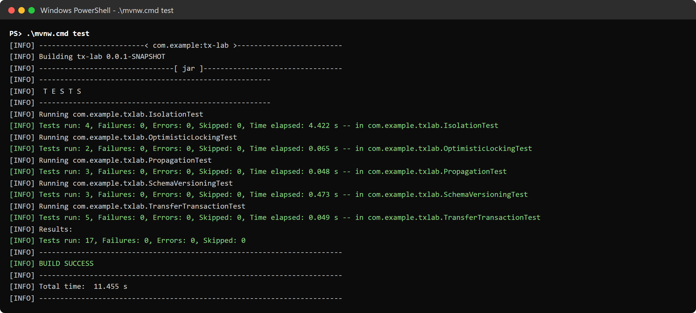
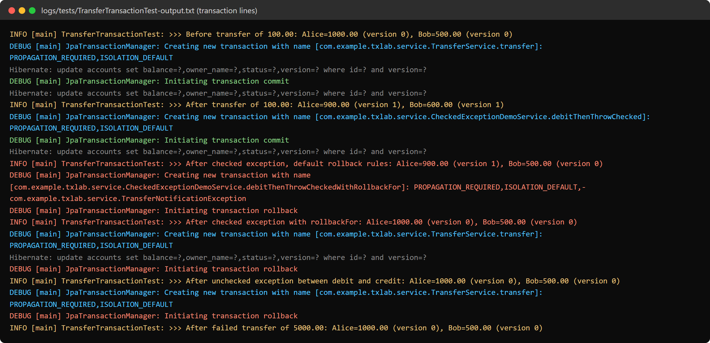
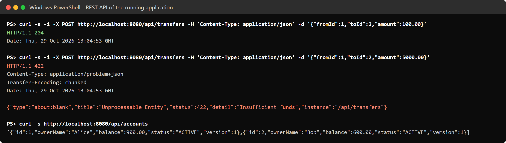
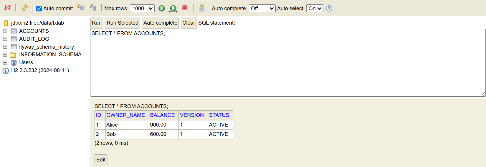
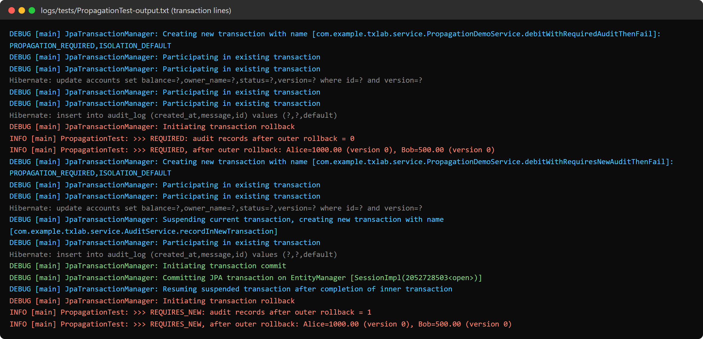
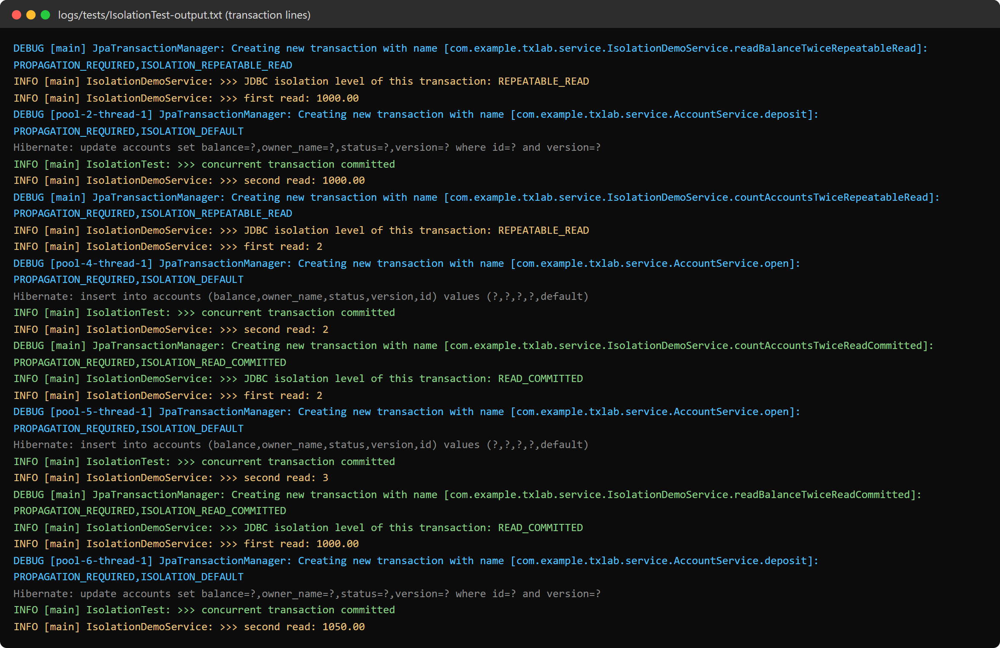
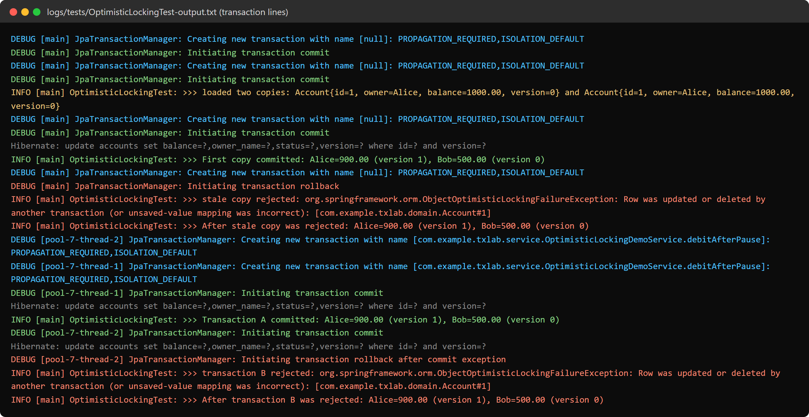
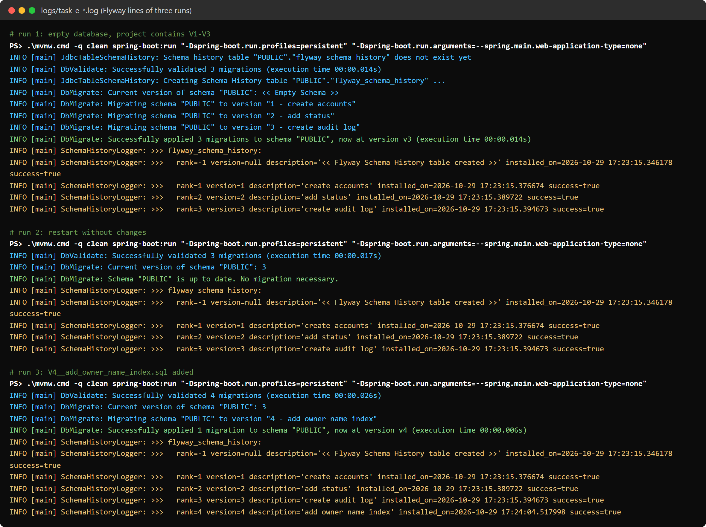
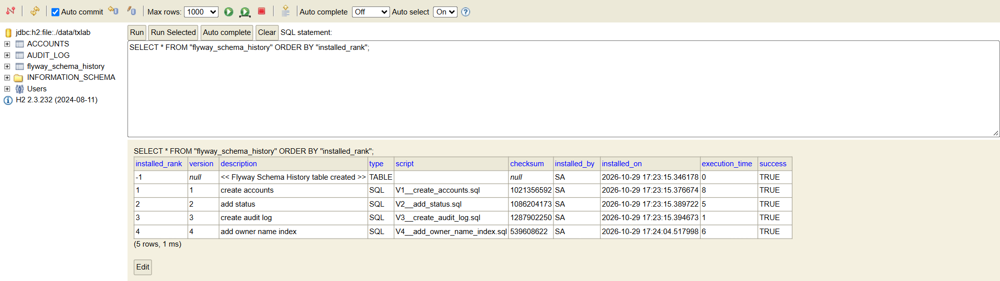
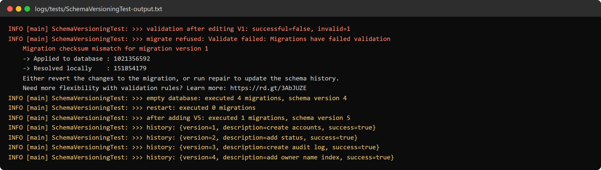

JSC «International Information Technology University»

Faculty of Business, Media and Management · Department of Information Systems

LABORATORY WORK No. 6

Spring transaction management and database schema versioning: declarative transactions, propagation, isolation, optimistic locking, Flyway

<table class="meta">
<tr><td>Discipline:</td><td>RWPSF 3305 — Web Application Development with Spring Framework</td></tr>
<tr><td>Educational programme:</td><td>6B06105 — Information Systems, year 3, semester 6</td></tr>
<tr><td>Lecturer:</td><td>Yestay Mergengali, Senior Lector</td></tr>
<tr><td>Surname, Name:</td><td>Sabyr Daryn</td></tr>
<tr><td>Group:</td><td>IT1-2411IS</td></tr>
<tr><td>Variant:</td><td>6</td></tr>
<tr><td>Date:</td><td>29.10.2026</td></tr>
</table>

## 1. Aim of the work and a link to the repository

The aim of the work is to implement and test transaction management in a Spring Boot application: to make a multi-step business operation atomic with **@Transactional**, to compare propagation and isolation settings, to protect data from lost updates with optimistic locking (**@Version**), and to version the database schema with **Flyway**. A separate objective is to observe how the actual database (H2) behaves instead of assuming it.

Repository (branch **lab06**): https://github.com/sabr0171/spring-lab-01/tree/lab06

The base package of the project is `com.example.txlab`: the entities are in `domain`, the repositories in `repository`, the services with the experiments in `service`, the REST controller in `web`, and the startup logger of the Flyway history in `config`. The migrations are in `src/main/resources/db/migration`.

| Component | Version |
|---|---|
| JDK | Temurin 25.0.4.1 (bytecode compiled for Java 17, `java.version=17`) |
| Spring Boot | 3.5.7 (Spring Web, Spring Data JPA, Spring Boot Test) |
| Hibernate ORM | 6.6.33.Final |
| Database | H2 2.3.232 (in-memory for the tests, file-based for Task E) |
| Migration tool | Flyway 11.7.2 (Liquibase is not used) |
| Build | Maven Wrapper (Maven 3.10.0) |

The tests are run with `mvnw test`. The application is started with `mvnw spring-boot:run -Dspring-boot.run.profiles=persistent`: the `persistent` profile uses the file database `./data/txlab`, so the schema survives a restart; without the profile the in-memory database from the assignment is used. While the application runs, the H2 Console is available at `http://localhost:8080/h2-console` (JDBC URL `jdbc:h2:file:./data/txlab`, user `sa`, empty password).

## 2. Listings

Import statements are omitted to save space; the full files are in the repository.

**Listing 1. Flyway migrations V1–V4**

[[listing: src/main/resources/db/migration/V1__create_accounts.sql, src/main/resources/db/migration/V2__add_status.sql, src/main/resources/db/migration/V3__create_audit_log.sql, src/main/resources/db/migration/V4__add_owner_name_index.sql]]

**Listing 2. Application configuration**

[[listing: src/main/resources/application.properties, src/main/resources/application-persistent.properties]]

**Listing 3. The entity with the version field**

[[listing: src/main/java/com/example/txlab/domain/Account.java]]

**Listing 4. The audit entity and the repositories**

[[listing: src/main/java/com/example/txlab/domain/AuditRecord.java, src/main/java/com/example/txlab/repository/AccountRepository.java, src/main/java/com/example/txlab/repository/AuditRecordRepository.java]]

**Listing 5. The transfer service and the failure injection (Task A)**

[[listing: src/main/java/com/example/txlab/service/TransferService.java, src/main/java/com/example/txlab/service/TransferFaultInjector.java, src/main/java/com/example/txlab/service/SimulatedFailureException.java]]

**Listing 6. Checked exceptions and rollbackFor (Task A)**

[[listing: src/main/java/com/example/txlab/service/CheckedExceptionDemoService.java, src/main/java/com/example/txlab/service/TransferNotificationException.java]]

**Listing 7. The inner audit service (Task B)**

[[listing: src/main/java/com/example/txlab/service/AuditService.java]]

**Listing 8. The outer service of the propagation experiment (Task B)**

[[listing: src/main/java/com/example/txlab/service/PropagationDemoService.java]]

**Listing 9. Reads under different isolation levels (Task C)**

[[listing: src/main/java/com/example/txlab/service/IsolationDemoService.java]]

**Listing 10. Optimistic locking and account operations (Task D)**

[[listing: src/main/java/com/example/txlab/service/OptimisticLockingDemoService.java, src/main/java/com/example/txlab/service/AccountService.java]]

**Listing 11. The REST controller and the error handler**

[[listing: src/main/java/com/example/txlab/web/AccountController.java, src/main/java/com/example/txlab/web/ApiExceptionHandler.java]]

**Listing 12. Logging of the Flyway history at startup (Task E)**

[[listing: src/main/java/com/example/txlab/config/SchemaHistoryLogger.java]]

**Listing 13. The base test class**

[[listing: src/test/java/com/example/txlab/AbstractLabTest.java]]

**Listing 14. Tests of Task A**

[[listing: src/test/java/com/example/txlab/TransferTransactionTest.java]]

**Listing 15. Tests of Task B**

[[listing: src/test/java/com/example/txlab/PropagationTest.java]]

**Listing 16. Tests of Task C**

[[listing: src/test/java/com/example/txlab/IsolationTest.java]]

**Listing 17. Tests of Task D**

[[listing: src/test/java/com/example/txlab/OptimisticLockingTest.java]]

**Listing 18. Tests of Task E**

[[listing: src/test/java/com/example/txlab/SchemaVersioningTest.java, src/test/resources/db/lab-extra/V5__add_balance_check.sql]]

## 3. Test run

All 17 tests pass (Figure 1). The tests are deliberately **not** annotated with `@Transactional`: the experiments need real commits and rollbacks, not one test transaction wrapped around everything. Instead, the data is reset before each test (Alice = 1000.00, Bob = 500.00).

## 4. Task A — Declarative transactions and rollback

`TransferService.transfer` is annotated with `@Transactional` (Listing 5). There is one difference from the code in the assignment: after the debit the service calls `saveAndFlush(from)`. This sends the UPDATE to the database before a possible failure, so the rollback test proves that the database undid the change, not merely that Hibernate never sent it.

| Test | Result | Alice | Bob |
|---|---|---|---|
| Transfer 100.00 | Success, commit | 900.00 | 600.00 |
| Transfer 5000.00 (more than the balance) | `IllegalStateException: Insufficient funds`, rollback | 1000.00 | 500.00 |
| `RuntimeException` after the debit, before the credit | Rollback; the already executed UPDATE is undone too (version back to 0) | 1000.00 | 500.00 |
| Checked exception after the debit, default rules | **Commit**: the money left Alice and arrived nowhere | 900.00 | 500.00 |
| The same with `rollbackFor = TransferNotificationException.class` | Rollback | 1000.00 | 500.00 |

**What changes with a checked exception.** By default Spring rolls back only on `RuntimeException` and `Error`. A checked exception is treated as an expected business outcome, so the transaction is **committed**: the caller receives an exception while the changes are already saved. The experiment confirmed it: 100.00 was debited from Alice and never reached Bob. The `rollbackFor` attribute adds the exception to the rollback rules; in the log it appears as `-com.example.txlab.service.TransferNotificationException` in the transaction definition, and the transaction is rolled back (Listing 6). The opposite attribute, `noRollbackFor`, disables rollback for a given unchecked exception.

**Check through the REST API.** The same scenarios were run against the started application: a successful transfer returns `204 No Content`, a transfer above the balance returns `422` with the detail "Insufficient funds". After that the database contains Alice = 900.00 and Bob = 600.00, both with version = 1.

## 5. Task B — Propagation

The outer method of `PropagationDemoService` debits an account, calls `AuditService` (a separate bean, so the call goes through the Spring proxy) and then fails with a `RuntimeException` after the audit call has returned (Listings 7 and 8).

| Propagation of the inner method | Audit record after the outer rollback | Alice's balance |
|---|---|---|
| `REQUIRED` | **absent** (0 records) | 1000.00 |
| `REQUIRES_NEW` | **present** (1 record) | 1000.00 |
| `MANDATORY`, called without a transaction | `IllegalTransactionStateException` | — |

**Why.** With `REQUIRED` the inner method joins the outer transaction ("Participating in existing transaction"). Physically it is one transaction, so the outer rollback also removes the audit record. With `REQUIRES_NEW` Spring suspends the outer transaction ("Suspending current transaction"), opens a new one on a separate connection and commits it before the method returns. The later rollback of the outer transaction cannot touch a record that is already committed. This is how audit trails and error journals are usually written: they must survive even when the business operation fails.

**Optional extension: the other propagation types.**
- `SUPPORTS`: runs inside a transaction if there is one, otherwise without it. Suitable for reads that do not require a transaction.
- `MANDATORY`: requires an existing transaction and throws otherwise (checked by a test). Suitable for methods that must never run outside a business operation, such as "debit an account".
- `NOT_SUPPORTED`: suspends the current transaction and runs without one. Suitable for long operations that do not write to the database (reports, calls to external services), so the connection and locks are not held.
- `NEVER`: throws if a transaction exists. A guard for code that must not run inside a transaction.
- `NESTED`: a nested transaction based on a savepoint. Only the inner part is rolled back, while the final commit belongs to the outer transaction. Suitable for "try a step and continue without it on failure". It needs JDBC savepoint support; with JPA the persistence context is not reset on a rollback to a savepoint, so it is used carefully.

## 6. Task C — Isolation and concurrent access

**Database:** H2 2.3.232, in-memory, MVStore engine (MVCC). Transaction 1 runs in the test thread and reads the same data twice. Between the reads, transaction 2 runs in another thread (its own connection from the pool), changes the data and commits. The reads use `JdbcTemplate` rather than the repository: a second `findById` would be answered from Hibernate's first-level cache and would never reach the database (Listing 9). The isolation level that was actually applied is read from `Connection.getTransactionIsolation()` and logged.

| Experiment | READ_COMMITTED | REPEATABLE_READ |
|---|---|---|
| Alice's balance; transaction 2 adds 50.00 | 1000.00 → **1050.00** (non-repeatable read) | 1000.00 → **1000.00** |
| Number of accounts; transaction 2 opens the account Charlie | 2 → **3** (phantom read) | 2 → **2** |

In both cases the database contains 1050.00 and 3 accounts after transaction 1 has finished: the change of transaction 2 was committed, transaction 1 simply did not see it. Transaction 2 was not blocked; it finished within 10–220 ms.

**Analysis.** Under READ_COMMITTED each statement sees the latest committed data, so the second read inside the same transaction returns the new value. Under REPEATABLE_READ H2 reads from a snapshot, so the second read returns the same value. The SQL standard allows phantoms at this level, yet in H2 the new row is not visible either. This is H2-specific behaviour and must not be generalised to other databases (see the answer to question 3).

## 7. Task D — Optimistic locking

Two experiments were run (Listings 10 and 17):
1. **Two copies loaded in independent transactions.** Both copies have `version = 0`. The first copy debits 100.00 and is saved (the version becomes 1). The second copy, now stale, tries to debit 300.00.
2. **Two threads.** Transactions A and B read the account at the same time. A debits 100.00 and commits, then B tries to commit its debit of 300.00.

The result is the same in both cases: the second write is rejected with `ObjectOptimisticLockingFailureException`, the balance stays 900.00 and the version is 1.

**Why the second update must not silently overwrite the first one.** The second transaction made its decision on stale data: it saw a balance of 1000.00 and would write 1000.00 − 300.00 = 700.00 over the current 900.00. The debit of the first transaction (100.00) would disappear without a trace. This is the classic **lost update** anomaly: the final balance matches no serial order of the two operations.

**A safe response to the conflict:**
- **Report the conflict.** In the project, `ApiExceptionHandler` turns `OptimisticLockingFailureException` into HTTP 409 Conflict asking the client to reload the data (Listing 11). The user sees the current state and decides what to do.
- **Refresh the data** and show it to the user, or recalculate the operation.
- **Retry automatically** only if the retry is safe: the whole transaction runs again, reads fresh data and re-checks the business rules (a transfer checks the balance again). A retry is not safe when a person made the decision on old data (an edit form) or when the operation has external side effects (an e-mail, a call to a payment gateway).

## 8. Task E — Schema versioning with Flyway

Migrations: `V1__create_accounts.sql` and `V2__add_status.sql` (as in the assignment), `V3__create_audit_log.sql` (the table for Task B) and `V4__add_owner_name_index.sql` (the new migration from step 4 of Task E), see Listing 1.

The application was started three times with the file database:
1. Empty database, the project contains V1–V3: Flyway created the history table and applied three migrations.
2. Restart without changes: "Schema "PUBLIC" is up to date. No migration necessary."
3. V4 added (an index on `owner_name`): only V4 was applied and the schema moved to version 4.

The `flyway_schema_history` table in the H2 Console after the third run is shown in Figure 9. V1–V3 have the same installation time (17:23:15), so they were not executed again on restart; V4 was installed later (17:24:04). The row with rank −1 is a service row: this is how Flyway 11 records the creation of the history table.

The same scenario is automated in `SchemaVersioningTest` (Listing 18): empty database → 4 migrations, restart → 0, a test migration `V5` added → 1. One more test shows what happens when an **already applied migration is edited**: the opening balance in a copy of V1 is changed, after which Flyway refuses to migrate because of a checksum mismatch.

**Why an applied versioned migration should not be edited.** Flyway stores the checksum of every applied migration and compares it with the file on startup. An edited file gives a checksum mismatch, and the application does not start. Bypassing the check would be worse: databases where V1 has already run would never receive the corrected version, while a new database would. The environments (dev, test, prod) would diverge, and the schema would no longer be defined by the set of migrations. The correct way is a new migration (V5 and later) that fixes the previous one.

## 9. Answers to the questions

**1. What does @Transactional do, and where should transaction boundaries normally be placed?**
Spring wraps the bean in a proxy. Before the method runs, the proxy opens a transaction (takes a connection and turns autocommit off); after a normal return it commits, and on a `RuntimeException` or `Error` it rolls back. The attributes set propagation, isolation, read-only mode, timeout and rollback rules. The boundary is normally placed on a **service-layer** method that performs one business use case (a unit of work), such as `transfer`. On a repository the boundary is too narrow: every save would be a separate transaction and the transfer would no longer be atomic. On a controller it is too wide: the transaction would include serialisation, HTTP handling and other work, holding the connection and locks longer. The annotation works only for calls through the proxy, so calling `this.method()` inside the same class bypasses it. Long external calls should not be made inside a transaction.

**2. What is the difference between REQUIRED and REQUIRES_NEW?**
`REQUIRED` (the default) joins an existing transaction or creates a new one if there is none. Everything runs in one physical transaction and is committed or rolled back as a whole. If the inner method throws, the whole transaction is marked rollback-only; even if the outer code catches the exception, the commit fails with `UnexpectedRollbackException`. `REQUIRES_NEW` suspends the current transaction and opens an independent one on a separate connection. Its result is committed immediately and does not depend on the outer transaction (in the experiment the audit record survived the rollback). The cost: a second pool connection (a small pool can deadlock), the inner transaction does not see uncommitted changes of the outer one, and it can block on rows locked by the outer one.

**3. Which anomalies are prevented by READ_COMMITTED and REPEATABLE_READ? Does behavior vary by database?**
- READ_COMMITTED prevents **dirty reads** (reading uncommitted data). Non-repeatable reads and phantom reads are possible; both were observed in the experiment.
- REPEATABLE_READ prevents dirty reads and **non-repeatable reads**. By the SQL standard, **phantom reads** are allowed.

The behaviour varies a lot, because the standard defines only minimal guarantees:
- **H2 2.3** (this experiment): REPEATABLE_READ reads from a snapshot, so the phantom is not visible either. The default level is READ_COMMITTED.
- **PostgreSQL**: the default is READ COMMITTED. REPEATABLE READ is snapshot isolation: no phantoms, and an attempt to update a row already changed by another transaction fails with a serialization error ("could not serialize access due to concurrent update"), so the transaction must be retried. READ UNCOMMITTED behaves as READ COMMITTED.
- **MySQL (InnoDB)**: the default is REPEATABLE READ. A plain SELECT reads a consistent snapshot, but locking reads (`SELECT ... FOR UPDATE`) and UPDATE see the latest data; gap locks protect against phantoms.
- **Oracle**: there is no REPEATABLE READ at all, only READ COMMITTED (the default) and SERIALIZABLE.

Therefore results obtained on H2 cannot be transferred to a production database automatically.

**4. How does @Version detect concurrent updates?**
Hibernate reads the version column together with the entity. On update it executes `UPDATE accounts SET ..., version = version + 1 WHERE id = ? AND version = ?` with the version that was read. If someone else has changed the row in the meantime, the version in the database is different, the UPDATE affects 0 rows, and Hibernate throws `StaleObjectStateException`. JPA converts it into `OptimisticLockException`, Spring into `ObjectOptimisticLockingFailureException`, and the transaction is rolled back. For a detached entity (`save()` through `merge`) Hibernate compares the versions even before the UPDATE. No locks are taken while reading, so the approach suits rare conflicts and long user "think time" between reading and writing.

**5. Why should migrations be version-controlled and immutable after deployment?**
The database schema is part of the application code: a given version of the code expects a given version of the schema (here `ddl-auto=validate` prevents startup without V2). Keeping migrations in Git gives history, code review, a link between schema changes and code changes, and reproducibility: any database, from an empty one to production, is brought to the same schema by the same sequence of steps. Immutability is needed because an applied migration never runs again on the databases where it has already run; editing it changes only new environments, and they diverge. Flyway protects against this with checksums (shown in Task E, Figure 10). Corrections are made with a new migration.

**6. When would you choose Flyway over Liquibase, or Liquibase over Flyway?**
**Flyway** fits when the team is comfortable writing migrations in the SQL of a specific database. It is simple: the naming convention `V<version>__<description>.sql`, minimal configuration and a short learning curve. It is a good choice for an application with one target database, as in this work. **Liquibase** fits when database independence is needed (changelogs in XML/YAML/JSON with change types such as `createTable` and `addColumn`, from which SQL is generated for each database), together with preconditions, contexts and labels for different environments, described rollbacks and schema diffs — for example, when a product ships on PostgreSQL, Oracle and MSSQL, or the deployment process is complex. Undo migrations in Flyway exist only in the paid edition.

## 10. Conclusion

In this laboratory work, I implemented a Spring Boot application with money transfers between accounts on Spring Data JPA and H2, experiments with transaction propagation, isolation and optimistic locking, and schema migrations with Flyway, covered by 17 automated tests. I observed that `@Transactional` makes the transfer atomic: a `RuntimeException` between the debit and the credit rolls back even an UPDATE that was already sent to the database, while a checked exception commits the transaction by default unless `rollbackFor` is set. The propagation experiment showed that an audit record written with `REQUIRED` is rolled back together with the outer transaction, while a record written with `REQUIRES_NEW` survives because it is committed in its own transaction. The isolation test on the H2 2.3.232 database showed that under READ_COMMITTED a second read sees changes committed by another transaction (non-repeatable and phantom reads), while under REPEATABLE_READ it returns the same snapshot, and even new rows stay invisible. Optimistic locking prevented a lost update: the stale copy could not overwrite the debit of the other transaction, and the balance stayed correct (900.00). The migration tool applied V1–V3 to the empty database, executed nothing again on restart, then applied only the new V4, and rejected an edit of an already applied migration because of a checksum mismatch. The main lesson learned was that transaction boundaries, rollback rules and isolation levels must be chosen explicitly and verified on the real database, and that the database schema must be versioned as strictly as the code.

**Notes.** Figures 4 and 9 are screenshots of the H2 Console of the running application. Figures 1–3, 5–8 and 10 show real console and log output from the `logs/` folder of the project; for readability only the lines about transactions, SQL and results are kept, and timestamps and package names are shortened. On a Windows account whose user name contains non-Latin characters, two environment issues appear: Mockito cannot attach its Java agent (solved by `src/test/resources/mockito-extensions/org.mockito.plugins.MockMaker`, which selects the agent-free mock maker; the tests use no mocks), and the embedded Tomcat cannot open its loopback channel (solved by starting with `-Dspring-boot.run.jvmArguments=-Djdk.net.unixdomain.tmpdir=C:\Users\Public\txlab-tmp`).
