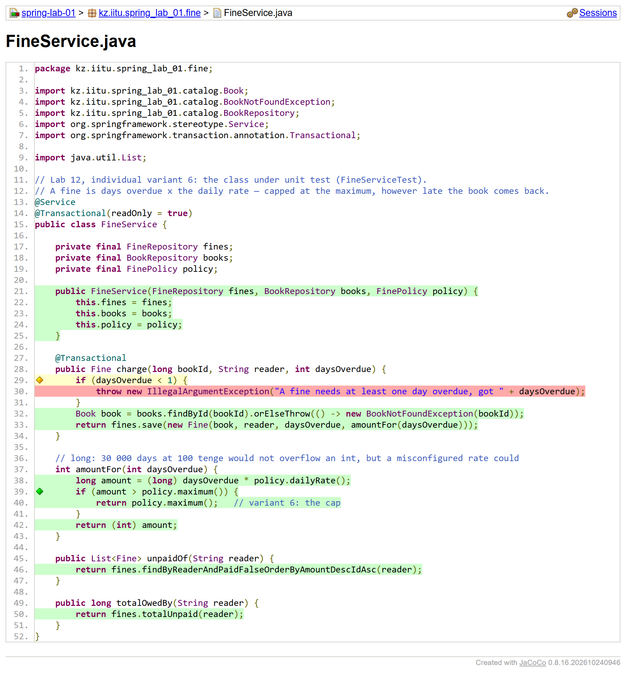
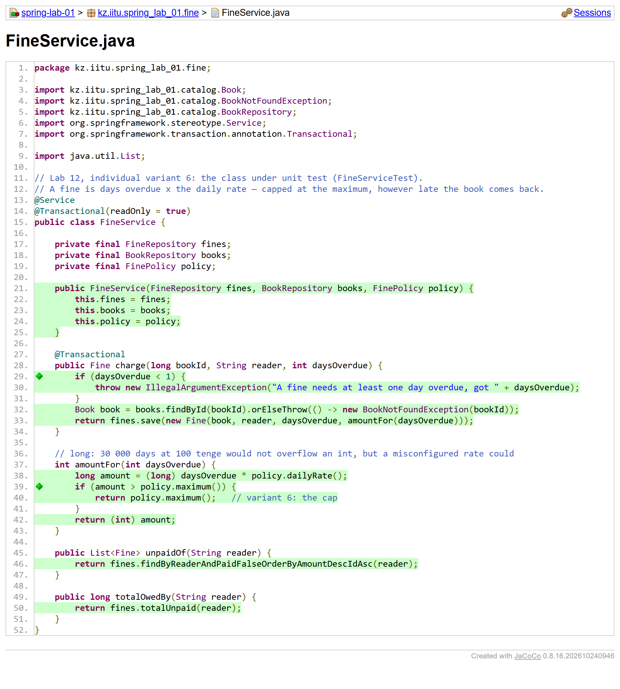

# Laboratory work 12 — evidence

Sabyr Daryn, IT1-2411 IS · branch `lab12` (from `lab10`) · **variant 6**

| Variant 6 | |
|---|---|
| Class under unit test | `FineService` (`kz.iitu.spring_lab_01.fine`) |
| Branch that must be covered | a fine capped at the maximum |
| Extra requirement | an `assertThatThrownBy` with a message assertion |
| Package reported for coverage | `kz.iitu.spring_lab_01.fine` |

Docker: **not installed on this computer** — task 4 is done as the assignment's fallback (section 4).
H2: **not used anywhere**; every test that needs a database talks to PostgreSQL 17.

## 1. The build

```
$ ./mvnw clean verify
[INFO] Tests run: 69, Failures: 0, Errors: 0, Skipped: 4
[INFO] Analyzed bundle 'spring-lab-01' with 29 classes
[INFO] BUILD SUCCESS
```

69 = the 46 tests of lab 10 + 23 new ones. The 4 skipped are `BookApiIntegrationTest` (Testcontainers), each with
the reason `disabledWithoutDocker is true and Docker is not available`; their twins in
`BookApiOnEmbeddedPostgresTest` run and pass. Logs next to the repository: `logs/lab12/01_mvnw_clean_verify.log`
(full) and `logs/lab12/05_tests.txt` (per class, and the name of every test case).

## 2. The tests

| Level | Class | Tests |
|---|---|---|
| Unit — JUnit 5, Mockito, AssertJ, no Spring | `fine/FineServiceTest` | happy path (3 days → 300); missing book → `BookNotFoundException` with its message (`assertThatThrownBy(...).hasMessage("Book 404 does not exist")`); `ArgumentCaptor` on `save` (book, reader, days, amount, unpaid); **variant branch**: 45 days would be 4500, the fine is 2000; task 5: 0 days → `IllegalArgumentException` with its message |
| Web slice — `@WebMvcTest`, `@MockitoBean` | `web/BookControllerTest` | 200 with the JSON fields (and the CSP header of lab 10); 404 problem detail; 400 listing `genre`, `title`, `year`; 401 with a Basic challenge; 403 for a reader's DELETE |
| Data slice — `@DataJpaTest`, `TestEntityManager` | `catalog/BookRepositoryTest`, `fine/FineRepositoryTest` | the lab-5 query finds the author's books / leaves out other authors and books with no author; unpaid fines biggest first / paid fines and other readers' fines left out, total 0 for nobody; the `days_overdue > 0` check of V6 |
| Integration — `@SpringBootTest(RANDOM_PORT)`, `RestTestClient` | `web/BookApiIntegrationTest` (Testcontainers), tests in `web/LibraryApiScenario` | book created then read back with its citation; fines 4 + 60 days → 400 + 2000, total 2400, someone else's fine not shown; 0 days → 400, missing book → 404; 401, 403 |

What the tests needed that was not in the repository (every change is commented in the code):

* **The variant.** Package `fine`: `Fine`, `FineRepository` (derived query with an `@EntityGraph`, JPQL total),
  `FinePolicy` (`app.fines.daily-rate=100`, `app.fines.maximum=2000`), `FineService`, `FineRestController`
  (`POST /api/books/{id}/fines` for ADMIN, `GET /api/fines/mine` for USER and ADMIN); migration `V6__fine.sql`.
* **Problem details** ("the `@RestControllerAdvice` from lab 7" — not in this repository): `BookNotFoundException`,
  `web/RestErrorAdvice` (404, and 400 with an `invalidFields` list); `BookService.requireById`.
* **An API filter chain.** In lab 10 `/api/**` fell through to `denyAll()`, so every API test would be a 403.
  `SecurityConfiguration.apiFilterChain` (`@Order(1)`): GET of books and `/api/fines/mine` for USER and ADMIN,
  fining and other writes for ADMIN, the rest of `/api` still `denyAll()`; HTTP Basic, stateless, CSRF off for this
  chain only, the CSP of variant 6 (lab 10) kept. Adjusted lab-10 tests: `AccessMatrixTest` (the "no rule" URL is
  now `/api/hello`), `UrlRuleIsNotEnoughTest` (its chain: `@Order(0)`, matcher `/api/books/**`),
  `SpringLab01ApplicationTests` (migrations 1, 2, 5, 6).

**Security in the slice test.** `@WebMvcTest` skips `@Configuration` classes, so without `@Import` it would test
Spring Boot's default chain. `SecurityConfiguration` is imported and `@WithMockUser` gives each request the role it
needs; the 401 and 403 tests prove the real rules are in force. Turning security off (`excludeAutoConfiguration`)
was not done: the test would then say nothing about access.

## 3. Coverage of `kz.iitu.spring_lab_01.fine` — before and after the extra test

| | Instructions | Branches | Lines | `FineService` |
|---|---|---|---|---|
| before | 230 / 248 — **92 %** | 3 / 4 — **75 %** | 44 / 46 | lines 14/15, branches 3/4 |
| after  | 236 / 248 — **95 %** | 4 / 4 — **100 %** | 45 / 46 | lines 15/15, branches 4/4 |

(the line still missed in the package is `Fine.toString()`; whole project after: 80 % of instructions,
47 % of branches.)

**Yellow → green.** `FineService.java`, line 29, `if (daysOverdue < 1) {` — "1 of 2 branches missed", and line 30
(the `throw`) red. Nothing could take the `true` side: the controller's `@Min(1)` answers 400 before the service
is called, and no unit test passed 0. The excerpt of the JaCoCo class view:

```
before  <span class="pc bpc" id="L29" title="1 of 2 branches missed.">        if (daysOverdue &lt; 1) {
        <span class="nc" id="L30">            throw new IllegalArgumentException("A fine needs at least one day overdue, got " + daysOverdue);
after   <span class="fc bfc" id="L29" title="All 2 branches covered.">        if (daysOverdue &lt; 1) {
        <span class="fc" id="L30">            throw new IllegalArgumentException("A fine needs at least one day overdue, got " + daysOverdue);
```

The test that did it (`FineServiceTest`):

```java
@Test
void zeroDaysOverdueIsRefusedBeforeAnythingIsLookedUp() {
    assertThatThrownBy(() -> service.charge(7L, "user", 0))
            .isInstanceOf(IllegalArgumentException.class)
            .hasMessage("A fine needs at least one day overdue, got 0");
    verifyNoInteractions(books, fines);
}
```

| Before | After |
|---|---|
|  |  |

Package view: [before](lab12/jacoco_fine_package_before.png) · [after](lab12/jacoco_fine_package_after.png).

**Still uncovered.** `BookService.delete`, line 59, `if (!repository.existsById(id))` misses its `true` side:
nobody ever deletes a book that does not exist. It should be tested, not deleted — that branch is what makes
`DELETE /api/books/{id}` answer 404 instead of 204, a promise of the API that no test checks yet.

## 4. Task 4 without Docker

**Command and error.**

```
$ docker info | head -3                (Git Bash)
bash: docker: command not found
PS> docker info                        (PowerShell)
docker : The term 'docker' is not recognized as the name of a cmdlet, function, script file, or operable program.
```

`C:\Program Files\Docker` does not exist. The test class was run once with a plain `@Testcontainers`:

```
$ ./mvnw test -Dtest=BookApiIntegrationTest
ERROR org.testcontainers.dockerclient.DockerClientProviderStrategy -- Could not find a valid Docker environment.
Caused by: java.lang.IllegalStateException: Could not find a valid Docker environment. Please see logs and check configuration
ContainerFetchException: Can't get Docker image: RemoteDockerImage(imageName=postgres:17-alpine, ...)
[ERROR] Tests run: 1, Failures: 0, Errors: 1, Skipped: 0
```

Committed with `@Testcontainers(disabledWithoutDocker = true)`: skipped here with the reason, run wherever Docker
is. There, the log would show `Creating container for image: postgres:17-alpine` and
`Container postgres:17-alpine started` once for the class (the field is `static`), before Spring Boot starts.
(`logs/lab12/02_docker_info.txt`, `logs/lab12/03_testcontainers_without_docker.txt`.)

**What the container test would have proved that the `@DataJpaTest` does not.**

1. *The application end to end.* `@DataJpaTest` starts repositories, Hibernate and Flyway only. The integration
   test goes through a real HTTP connection to Tomcat, both security filter chains (Basic login checked by BCrypt
   against `app_user`), Jackson, Bean Validation, `RestErrorAdvice`, the `@Transactional` services and
   `@PreAuthorize`. That fining is ADMIN-only, that `/api/fines/mine` shows the caller's fines and nobody else's,
   that the cap holds for a fine charged through the API — only this test sees it.
2. *Committed data.* Each `@DataJpaTest` method is a transaction rolled back at the end. Here each request
   commits on its own, and the statement of `/api/fines/mine` is read in a later transaction than the fines it
   sums. It would also catch a lazy association touched after the transaction (open-in-view is off) — the reason
   `FineRepository` fetches the book with an `@EntityGraph`.
3. *The real server, wired by Spring Boot.* A fresh `postgres:17` (alpine) — the image `compose.yaml` uses —
   migrated by Flyway V1, V2, V5, V6, connected by `@ServiceConnection` without any hand-written URL.

`BookApiOnEmbeddedPostgresTest` runs the same tests on an embedded PostgreSQL 17 of its own, and they pass. It is
not Testcontainers: no image, no container, no `@ServiceConnection` — it covers points 1 and 2 on this computer,
not point 3.

## 5. Build changes this computer needed

The project lives in `C:\Users\Айнур\OneDrive\Рабочий стол\…` — Cyrillic letters, inside OneDrive.

| Problem | Fix in `pom.xml` |
|---|---|
| The test JVM died with `processing of -javaagent failed`: the JVM decodes `-javaagent` options in the wrong charset and JaCoCo's `destfile=C:\Users\Айнур\…` became `C:\Users\?????\…` | `prepare-agent` writes `jacocoArgLine`; `build-helper:regex-property` rewrites the destfile to `target/jacoco.exec` (relative, the same file) |
| `Mockito … Could not self-attach to current VM` | Mockito as `-javaagent:${org.mockito:mockito-core:jar}` (`dependency:properties`), as Mockito's docs recommend for JDK 21+ |
| `Unable to establish loopback connection` in Tomcat and `RestTestClient`: the JDK's Unix-domain socket in a non-ASCII `%TEMP%` | profile `windows`: `-Djdk.net.unixdomain.tmpdir=%PUBLIC%` for the test JVM |
| `mvnw clean`: `AccessDeniedException` on `target\classes\…` (OneDrive makes folders read-only) | `maven.clean.force=true` |
| The assignment's `org.testcontainers:postgresql` / `junit-jupiter` are not in Boot 4.1's BOM | Testcontainers 2.0.5 names: `testcontainers-postgresql`, `testcontainers-junit-jupiter`; class `org.testcontainers.postgresql.PostgreSQLContainer` |

None of them changes what a test checks.
